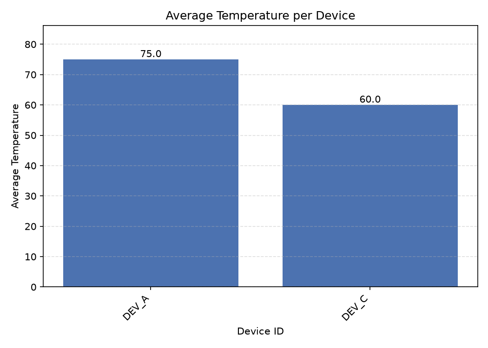

# Device Log Summarizer

A small Python project that reads device telemetry from a CSV file, summarizes
readings by device, writes the results to JSON, and plots average temperatures.

## Requirements

- Python 3
- Matplotlib

Install the Python dependency with:

```bash
python -m pip install -r requirements.txt
```

## Usage

Run these commands from the project directory:

```bash
python main.py
python plot_chart.py
```

`main.py` reads `device_telemetry.csv`, prints a summary, and writes
`summary.json`. Invalid or non-finite temperature records are skipped, and
devices with an average temperature above 80 are omitted from the summary.
Records with an `ERROR` status are counted as errors.

`plot_chart.py` reads `summary.json`, displays a chart, and saves it as
`average_temperature_by_device.png`.

## Input format

`device_telemetry.csv` must include these columns:

| Column | Description |
| --- | --- |
| `device_id` | Device identifier |
| `status` | Reading status; `ERROR` is counted as an error |
| `temperature` | Numeric temperature value |

Example:

```csv
device_id,status,temperature
DEV_A,ACTIVE,70
DEV_A,ERROR,80
```

## Other files

- `clean_readings.py` contains a helper for filtering and bounding temperature
  values, along with a few inline assertions.
- `summary.json` and `average_temperature_by_device.png` are example output
  files.

## Example chart


